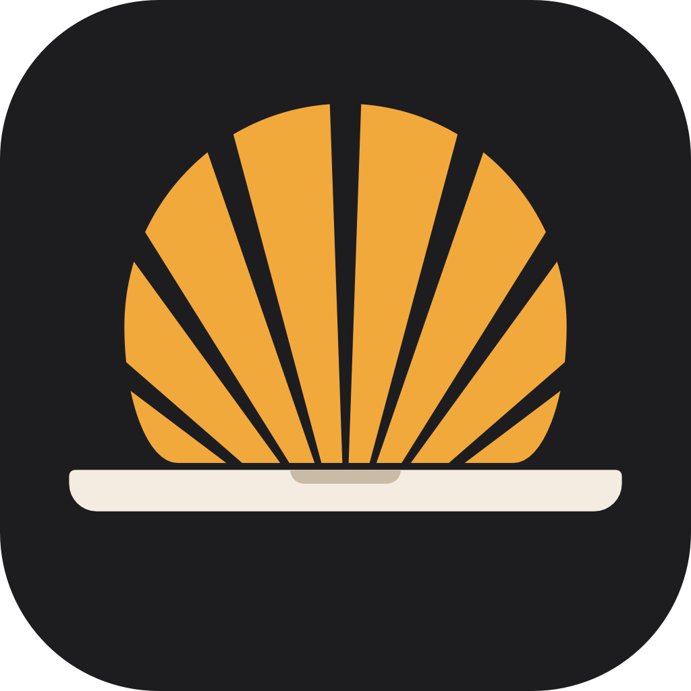

<div align="center">



# Clam

A macOS menu bar app that keeps your Mac awake with the lid closed.


[](LICENSE)

</div>

## What it does

You arm Clam from the menu bar icon, with a global hotkey, or from a Shortcuts action. While it's armed, closing the lid doesn't put the Mac to sleep. If you only need that once, hold Option as you close the lid and it disarms again when you open it.

With the lid closed the display is off by default. There's a second mode that leaves it on at zero brightness, because screen capture stops working on a display that's off and agents that drive the screen need it. That mode locks the Mac when you open the lid, and it uses more battery.

Clam disarms itself when the battery gets low (you pick the percentage) or the Mac runs hot. A separate watchdog process puts normal sleep back if the app crashes while armed.

## Building

Requires macOS 14 or later and Xcode 16 or later.

Open `Clam.xcodeproj` and run the `Clam` scheme, or build from the command line:

```sh
xcodebuild -project Clam.xcodeproj -scheme Clam build
```

Run the tests for the core package:

```sh
swift test --package-path ClamCore
```

### Signing

Copy `Config/Local.example.xcconfig` to `Config/Local.xcconfig` and set your team ID. That file is not checked in.

### Release builds

```sh
scripts/build-release.sh <team-id>
```

Builds a Developer ID signed release build and prints the path to `Clam.app`. It needs that team's Developer ID certificate. Without the argument it uses `Config/Local.xcconfig`, or asks.

## Layout

| Path | Contents |
| --- | --- |
| `App/` | The menu bar app |
| `ClamCore/` | Swift package with the session logic, hardware access and tests |
| `Watchdog/` | The helper that cleans up if the app dies while armed |

## License

MIT. See [LICENSE](LICENSE).
